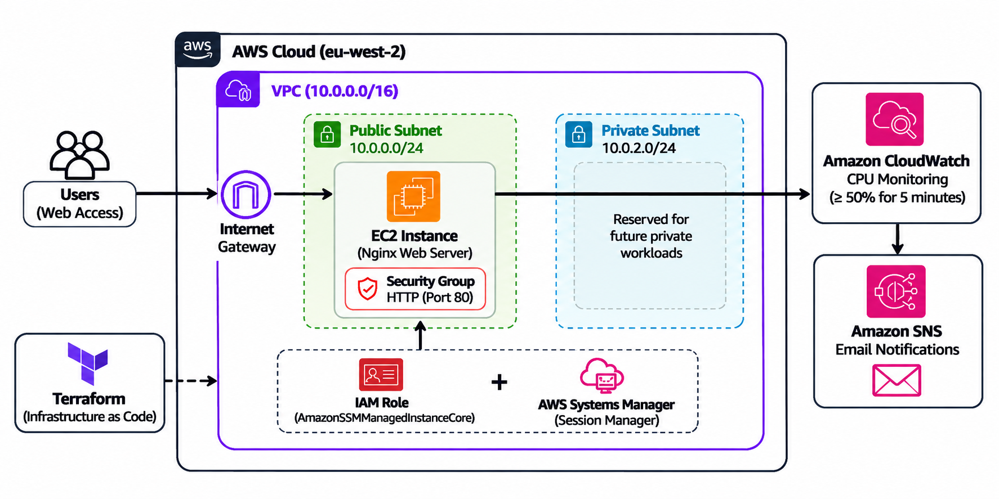

# AWS Cloud Infrastructure Deployment with Terraform

## Project Overview

For this project, I built and deployed AWS infrastructure using Terraform to improve my hands-on cloud engineering skills.

I created a custom VPC with public and private subnets, deployed an EC2 instance running Nginx and configured the networking needed to make the website accessible.

I also used IAM and AWS Systems Manager Session Manager for secure remote access without opening SSH to the internet.

I also set up CloudWatch CPU monitoring and SNS email alerts.

During deployment, I ran into an issue with my Nginx installation. I investigated it using the AWS CLI, Linux commands and cloud-init logs before fixing the problem.

Once everything was working, I tested the infrastructure and destroyed the AWS resources using Terraform to avoid unnecessary charges.

## AWS Architecture



The infrastructure was deployed in the AWS London region (`eu-west-2`).

| Resource | Configuration |
|---|---|
| VPC | `10.0.0.0/16` |
| Public subnet | `10.0.0.0/24` |
| Private subnet | `10.0.2.0/24` |
| EC2 | `t3.micro` running Amazon Linux 2023 |
| Security Group | Inbound HTTP on port 80 |
| Internet Gateway | Internet access for the public subnet |
| IAM and Session Manager | Secure access without opening SSH |
| CloudWatch and SNS | CPU monitoring and email alerts |

The EC2 instance was placed in the public subnet to host the Nginx website. I kept the private subnet separate for potential future workloads.

I didn't use a NAT Gateway because the private subnet wasn't hosting anything that needed outbound internet access.

## Technologies Used

- **Terraform:** Infrastructure as Code to create and manage AWS resources.
- **AWS VPC and EC2:** Networking and web server deployment.
- **IAM and Systems Manager:** Secure remote access.
- **CloudWatch and SNS:** CPU monitoring and email notifications.
- **AWS CLI and Linux:** Troubleshooting and infrastructure checks.
- **Nginx:** Hosting the website.
- **Git and GitHub:** Version control and documentation.

## Deployment Process

I deployed the infrastructure using Terraform from my VS Code terminal.

First, I initialised Terraform and checked the configuration:

```bash
terraform init
terraform fmt
terraform validate
terraform plan
```

After reviewing the planned changes, I deployed the infrastructure:

```bash
terraform apply
```

I used an EC2 user-data script to automatically update the instance, install Nginx and start the web server.

The script also included retry logic and error handling to help with installation failures.

## Troubleshooting

One of the biggest challenges I faced was when my Nginx website wouldn't load using the EC2 public IP address.

I started by checking whether the instance was running and had the correct public IP.

```bash
aws ec2 describe-instances --instance-ids <INSTANCE_ID> --query "Reservations[*].Instances[*].[State.Name,PublicIpAddress]" --output table
```

The instance was running, so I investigated the VPC subnets and Network ACL rules.

```bash
aws ec2 describe-subnets --filters "Name=vpc-id,Values=<VPC_ID>"

aws ec2 describe-network-acls --filters "Name=association.subnet-id,Values=<SUBNET_ID>"
```

I then connected to the instance using Session Manager and checked the Nginx service.

```bash
sudo systemctl status nginx
sudo ss -tulpn
```

I discovered that Nginx wasn't installed and nothing was listening on port 80.

After checking the cloud-init logs, I found an execution-format error.

```bash
sudo cat /var/log/cloud-init-output.log
sudo cat /var/lib/cloud/instance/scripts/part-001
```

The issue turned out to be a blank line before `#!/bin/bash` in my user-data script, which prevented Linux from recognising the script correctly.

I removed the blank line and used Terraform to replace the EC2 instance.

After redeploying, I tested the website again and received an HTTP 200 OK response.

This was probably the most useful part of the project because I had to investigate the problem rather than just follow deployment instructions.

## Monitoring and Alerts

I configured CloudWatch to monitor EC2 CPU utilisation using detailed monitoring.

The alarm was set to trigger when average CPU usage reached or exceeded **50% for five consecutive one-minute periods**.

I created an SNS topic called `project-1-cpu-alerts` and configured an email subscription.

I also used a Terraform variable to avoid putting my personal email address directly into the public Terraform code.

To test the notification system, I manually changed the alarm state using AWS CLI:

```bash
aws cloudwatch set-alarm-state \
  --alarm-name "project_1_alarm_cpu" \
  --state-value ALARM \
  --state-reason "testing purposes" \
  --region eu-west-2
```

I successfully received the SNS email notification, confirming the alerting process worked.

This tested the notification system rather than generating real CPU load.

## Testing and Results

After deployment, I carried out several checks to make sure the infrastructure was working.

| Test | Result |
|---|---|
| EC2 instance running | Passed |
| Nginx website accessible | Passed |
| HTTP 200 OK response | Passed |
| Session Manager connection | Passed |
| CloudWatch alarm configured | Passed |
| SNS email notification received | Passed |
| Terraform infrastructure cleanup | Passed |

To verify the website, I used:

```bash
curl http://<EC2_PUBLIC_IP>
curl -I http://<EC2_PUBLIC_IP>
```

The website returned:

```text
Project 1 - AWS Cloud Engineer Portfolio
```

The HTTP response confirmed that Nginx was running and accessible.

## Infrastructure Cleanup

After completing the tests, I reviewed the Terraform destruction plan:

```bash
terraform plan -destroy
```

The plan showed 20 resources scheduled for removal.

I then destroyed the infrastructure:

```bash
terraform destroy
```

Afterwards, I checked the AWS Console to confirm that the project resources had been removed and weren't left running unnecessarily.

## What I Learned

This project gave me more confidence working with AWS, Terraform and Linux.

I gained practical experience deploying infrastructure, configuring secure access, setting up monitoring and troubleshooting problems.

The main thing I learned was the importance of checking logs and investigating issues properly before making changes.

It also helped me understand how Terraform can be used to manage the full infrastructure lifecycle, from deployment through to cleanup.